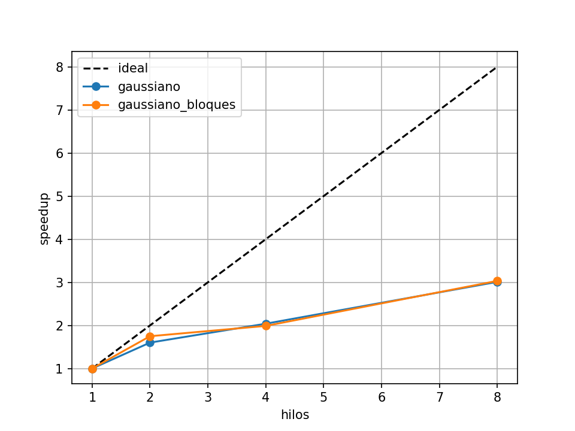

# 02. Motor: filtros, paralelización y mediciones

## Máquina de medición

| Campo | Valor |
|---|---|
| Procesador | AMD Ryzen 5 3400G (4 núcleos físicos, 8 hilos lógicos, SMT) |
| Caché | L1d 32 KiB y L2 512 KiB por núcleo, L3 4 MiB compartida |
| Memoria | 3.8 GiB asignados a WSL2; swap de 1 GiB sin uso durante las mediciones |
| Sistema | Ubuntu sobre WSL2 (hipervisor de Microsoft) |
| Compilador | g++ 15.2.0, `-std=c++17 -O2 -Wall -Wextra -fopenmp` |

Todas las mediciones de este documento salen de esta misma máquina, con el portátil conectado a la corriente y sin programas pesados abiertos.

## Gaussiano separable

Se implementa en dos pasadas. La horizontal aplica el núcleo binomial `[1 4 6 4 1]/16` sobre la imagen de entrada y guarda el resultado intermedio `T` en `double`, sin redondear. La vertical aplica el mismo núcleo sobre `T` y redondea solo al final, con empates hacia arriba y saturación a [0, 255]. Los bordes se resuelven por repetición del píxel más cercano.

Se entregan tres versiones con la misma aritmética:

- **Secuencial** (`gaussiano_secuencial`): referencia de corrección y de tiempo T(1) del algoritmo original.
- **Paralela** (`gaussiano_paralelo`): cada pasada es un `#pragma omp parallel for schedule(static)` sobre filas. La primera pasada escribe `T` dentro de la región paralela, así que la puesta a cero y la primera escritura se reparten entre hilos. El fin del primer `parallel for` actúa como barrera antes de la segunda pasada.
- **Por bloques** (`gaussiano_bloques`): cada bloque de 16 filas de salida calcula en un buffer privado de cada hilo solo las filas de `T` que necesita (16 más 4 de vecindad), y aplica la pasada vertical sobre ese buffer. No se guarda `T` completo.

**Justificación del reparto por filas.** La imagen se almacena por filas, así que una banda de filas es un bloque contiguo en memoria. Repartir por filas da a cada hilo una zona de memoria continua y evita que dos hilos escriban en líneas de caché vecinas al repartir columnas.

**Política de planificación.** `schedule(static)`: las filas tienen el mismo costo, así que un reparto fijo basta y no añade gasto de planificación dinámica.

## Corrección

Salida de `make clean && make pruebas`, con la versión final del motor:

```
g++ -std=c++17 -O2 -Wall -Wextra -fopenmp -Isrc -o motor src/main.cpp src/filtros.cpp src/imagen.cpp
g++ -std=c++17 -O2 -Wall -Wextra -fopenmp -Isrc -o comparar tests/comparar.cpp
g++ -std=c++17 -O2 -Wall -Wextra -fopenmp -Isrc -o generar bench/generar.cpp src/imagen.cpp
g++ -std=c++17 -O2 -Wall -Wextra -fopenmp -Isrc -o arnes bench/arnes.cpp src/filtros.cpp src/imagen.cpp
g++ -std=c++17 -O2 -Wall -Wextra -fopenmp -Isrc -o test_gaussiano tests/test_gaussiano.cpp src/filtros.cpp src/imagen.cpp
bash tests/pruebas.sh
Salida esperada, calculada aparte:
  ok    gris sobre la imagen de prueba
  ok    caja sobre la imagen de prueba
Lectura y escritura:
  ok    gris rechaza una imagen de un canal
  ok    caja sobre un canal escribe P5
Paralelo contra secuencial, imagen de 512x512:
  ok    gris idéntico con 1 hilo(s)
  ok    gris idéntico con 8 hilo(s)
  ok    caja idéntico con 1 hilo(s)
  ok    caja idéntico con 8 hilo(s)
  ok    gaussiano idéntico con 1 hilo(s)
  ok    gaussiano idéntico con 8 hilo(s)
Gaussiano separable contra forma directa 5x5:
  ok    gaussiano separable contra forma directa
Filtro desconocido:
  ok    la cadena con un filtro inexistente se rechaza
Cadenas que no se pueden aplicar:
  ok    sobel se rechaza antes de aplicar nada
  ok    gris,gris se rechaza antes de aplicar nada
  ok    otsu se rechaza antes de aplicar nada

todas las pruebas pasaron
```

La compilación no produce avisos con `-Wall -Wextra`.

Comparación del gaussiano con la forma directa 5x5 y con la versión por bloques (`./test_gaussiano`):

```
Gaussiano separable contra forma directa 5x5, imágenes aleatorias:
  ok    gaussiano 1x1 con 1 canal(es), secuencial
  ok    gaussiano 1x1 con 1 canal(es), paralelo
  ok    gaussiano 1x1 con 1 canal(es), bloques
  ok    gaussiano 2x3 con 1 canal(es), secuencial
  ok    gaussiano 2x3 con 1 canal(es), paralelo
  ok    gaussiano 2x3 con 1 canal(es), bloques
  ok    gaussiano 7x5 con 1 canal(es), secuencial
  ok    gaussiano 7x5 con 1 canal(es), paralelo
  ok    gaussiano 7x5 con 1 canal(es), bloques
  ok    gaussiano 37x23 con 1 canal(es), secuencial
  ok    gaussiano 37x23 con 1 canal(es), paralelo
  ok    gaussiano 37x23 con 1 canal(es), bloques
  ok    gaussiano 16x9 con 3 canal(es), secuencial
  ok    gaussiano 16x9 con 3 canal(es), paralelo
  ok    gaussiano 16x9 con 3 canal(es), bloques
  ok    gaussiano 64x48 con 3 canal(es), secuencial
  ok    gaussiano 64x48 con 3 canal(es), paralelo
  ok    gaussiano 64x48 con 3 canal(es), bloques
Gaussiano separable contra forma directa 5x5, imagen de prueba:
  ok    gris.pgm, secuencial
  ok    gris.pgm, paralelo
  ok    gris.pgm, bloques
gaussiano: todas las pruebas pasaron
```

La comparación paralela contra secuencial se hace byte a byte con 1 y 8 hilos, mediante `comparar`, dentro de `pruebas.sh`.

## Tiempos y escalado

Imagen de medición: 4096 × 4096 en color, generada con `generar`. Se miden cinco repeticiones por configuración con `bench/medir.sh`. Se descarta la primera y se reporta la mediana de las cuatro restantes. El tiempo es de pared alrededor del filtro, sin lectura ni escritura del archivo.

**Referencia secuencial original** (`arnes gaussiano ... --secuencial`): T(1) = 1012.54 ms, con dispersión entre 980 y 1194 ms.

### Versión paralela

| p | T(p) ms | S(p) = T(1)/T(p) | E(p) = S(p)/p |
|---|---|---|---|
| 1 | 967.12 | 1.00 | 1.00 |
| 2 | 604.10 | 1.60 | 0.80 |
| 4 | 474.18 | 2.04 | 0.51 |
| 8 | 321.36 | 3.01 | 0.38 |

### Versión por bloques

| p | T(p) ms | S(p) = T(1)/T(p) | E(p) = S(p)/p | Mínimo–máximo (ms) |
|---|---|---|---|---|
| 1 | 554.67 | 1.00 | 1.00 | 540.02–661.23 |
| 2 | 317.11 | 1.75 | 0.87 | 307.87–394.32 |
| 4 | 278.97 | 1.99 | 0.50 | 270.23–281.08 |
| 8 | 182.87 | 3.03 | 0.38 | 179.01–188.52 |

### Comparación contra la referencia secuencial

| p | Paralela T(p) ms | Por bloques T(p) ms | Por bloques frente a secuencial original | Por bloques frente a la paralela |
|---|---|---|---|---|
| 1 | 967.12 | 554.67 | 1.83 | 1.74 |
| 2 | 604.10 | 317.11 | 3.19 | 1.90 |
| 4 | 474.18 | 278.97 | 3.63 | 1.70 |
| 8 | 321.36 | 182.87 | 5.54 | 1.76 |

La columna de la versión por bloques frente a la secuencial original mezcla dos efectos: la mejora de localidad, que ya aparece con un hilo, y el paralelismo. Por eso la superlinealidad aparente con 2 hilos (eficiencia 1.60 frente a la referencia) no es escalado real. El escalado propio de la versión por bloques es la columna S(p) de la tabla anterior.

### Gráfica de speedup



La gráfica muestra las dos versiones del gaussiano, cada una con su propio T(1), y la recta ideal. Las curvas de los demás filtros y de la cadena completa no están medidas en este documento todavía.

## Perfilado

Herramientas: `/usr/bin/time -v` para memoria y fallos de página, y `perf stat` para tiempo y fallos de página. Los contadores de hardware no están disponibles en WSL2: `cpu-cycles` aparece como no soportado, así que no se puede medir la tasa de fallos de caché.

| Medición | Paralela | Por bloques |
|---|---|---|
| Memoria residente máxima, 1 hilo | 495 704 KiB | 117 888 KiB |
| Fallos de página menores, 1 hilo | 123 054 | 28 608 |
| Fallos de página, 4 hilos, 5 llamadas | 565 413 | 76 744 |
| Tiempo de usuario, 4 hilos, 5 llamadas | 6.81 s | 4.95 s |
| Tiempo de sistema, 4 hilos, 5 llamadas | 1.61 s | 0.24 s |

Conclusión del perfilado. La versión paralela necesita unos 480 MiB por llamada, de los cuales 384 MiB corresponden al intermedio `T` en color (4096 × 4096 × 3 × 8 bytes). Una parte importante del tiempo de sistema se debe a asignar y tocar esas páginas. Al pasar a la versión por bloques, la memoria máxima baja a unos 118 MiB, los fallos de página se reducen cerca de siete veces con 4 hilos y el tiempo de sistema baja de 1.61 s a 0.24 s. Esas reducciones son mediciones directas. La explicación de caché (que el buffer por bloque cabe en L2 y se reutiliza) es la interpretación más probable, pero no se comprobó con contadores de hardware.

## Optimización de localidad

**Elección del filtro.** El gaussiano es el filtro que peor escala: su eficiencia cae de 0.80 a 0.38 entre 2 y 8 hilos, y su intermedio `T` ocupa 384 MiB frente a una caché L3 de 4 MiB. Por eso se eligió para la optimización.

**Qué cambió en el acceso a memoria.** La versión paralela recorre la imagen completa en la primera pasada, escribe `T` completo y luego lo vuelve a leer en la segunda. La versión por bloques recorre la imagen en bloques de 16 filas: calcula en un buffer privado de cada hilo las filas de `T` que necesita, y aplica la pasada vertical sobre ese buffer antes de pasar al siguiente bloque. Así `T` nunca ocupa su tamaño completo, las filas se reutilizan mientras siguen en caché y se reduce el tráfico de memoria. El costo es recalcular 4 filas de vecindad por bloque, que se paga a cambio de no tocar 384 MiB de memoria.

**Medición antes y después.** Con el mismo arnés y las mismas cinco repeticiones:

| p | Paralela T(p) ms | Por bloques T(p) ms | Mejora |
|---|---|---|---|
| 1 | 967.12 | 554.67 | 1.74× |
| 2 | 604.10 | 317.11 | 1.90× |
| 4 | 474.18 | 278.97 | 1.70× |
| 8 | 321.36 | 182.87 | 1.76× |

La mejora es consistente en todos los números de hilos, incluido el de un hilo, donde no hay paralelismo y la diferencia viene solo del acceso a memoria.

**Salida idéntica.** La versión por bloques cumple las pruebas de `test_gaussiano` y de `pruebas.sh`, que comparan la salida byte a byte con la secuencial. Como la aritmética y el orden de suma son los mismos, no cambia el resultado.

## Evidencia de salida paralela idéntica

La evidencia está en las secciones de Corrección: `pruebas.sh` compara byte a byte la salida paralela con la secuencial para `gris`, `caja` y `gaussiano`, con 1 y 8 hilos, y `test_gaussiano` compara las tres versiones del gaussiano contra la forma directa 5x5.